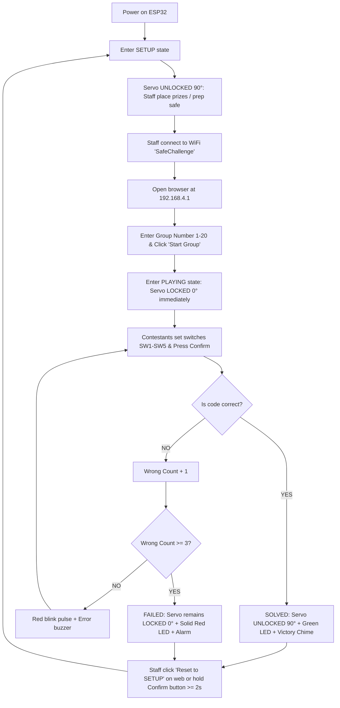

# Neptune's Vault — Safe Challenge (ESP32)

An interactive, microcontroller-based electronic safe box challenge designed for **Circuit & Logic Workshops**. Powered by an **ESP32 Dev Module**, the system operates in a completely standalone environment without requiring an external internet connection. Staff and workshop organizers can manage game rounds, inspect group answer keys, and monitor physical hardware signals in real-time via a built-in **Web Admin Console** served over ESP32's local WiFi Access Point.

---

## 📌 Key Features

- **Embedded WiFi Access Point (SoftAP)**: Broadcasts its own private WiFi network (`SafeChallenge`). Staff can connect using any smartphone, tablet, or laptop and open `http://192.168.4.1`.
- **Real-Time Live Hardware Monitor**: The web interface polls board status every **300 ms**, showing live states of all 5 binary switches, the confirm button, status LEDs, and current servo angle.
- **Instant Group Answer Key Display**: Selecting a group (1–20) immediately displays the target code in both decimal and 5-bit binary formats, explicitly listing which switches must be turned `ON`.
- **3-Attempt Lockout Enforcement**: Contestants are allowed up to **3 incorrect attempts per group**. Reaching 3 failed attempts triggers the `FAILED` state, sounding an alarm tone, illuminating the red LED, and keeping the door locked until staff reset the system.
- **Smart Servo Latch Lifecycle**:
  - **`SETUP` (Standby / Preparation)**: Servo is **UNLOCKED (90°)** so staff can easily open the door, configure the safe, or place flags and prizes inside.
  - **`PLAYING` (Round Active)**: Servo transitions immediately to **LOCKED (0°)** upon starting a group, securing the vault for contestants.
  - **`SOLVED` (Correct Code)**: Servo transitions to **UNLOCKED (90°)**, turning on the green LED and playing a victory chime.
  - **`FAILED` (3 Failed Attempts)**: Servo remains **LOCKED (0°)** with red error feedback.
- **Multi-Function Confirm Button**:
  - **Short Press (< 2 seconds)**: Submits the current switch code.
  - **Long Press (≥ 2 seconds)**: Resets the game back to `SETUP` mode (hardware fallback for the web reset button).
- **Non-Blocking Architecture**: LED flashing and buzzer tone melodies are driven asynchronously using `millis()`, ensuring zero latency or stuttering for web server requests.
- **Cross-Framework Compatibility**: Fully compatible with both **PlatformIO** and **Arduino IDE** (ESP32 Core 2.x and 3.x supported).

---

## 🔌 Hardware Wiring & Pinout

The GPIO pins are chosen to avoid ESP32 strapping pins (`GPIO 0, 2, 5, 12, 15`) and input-only pins without internal pull-ups (`GPIO 34–39`):

| Component             | ESP32 GPIO |    Pin Mode    | Circuit Description                                                    |
| :-------------------- | :--------: | :------------: | :--------------------------------------------------------------------- |
| **SW1 (Bit 0 - LSB)** | `GPIO 13`  | `INPUT_PULLUP` | One pin to GPIO, other to GND (`LOW` when switch is ON / closed = `1`) |
| **SW2 (Bit 1)**       | `GPIO 14`  | `INPUT_PULLUP` | One pin to GPIO, other to GND (`LOW` when switch is ON / closed = `1`) |
| **SW3 (Bit 2)**       | `GPIO 27`  | `INPUT_PULLUP` | One pin to GPIO, other to GND (`LOW` when switch is ON / closed = `1`) |
| **SW4 (Bit 3)**       | `GPIO 26`  | `INPUT_PULLUP` | One pin to GPIO, other to GND (`LOW` when switch is ON / closed = `1`) |
| **SW5 (Bit 4 - MSB)** | `GPIO 25`  | `INPUT_PULLUP` | One pin to GPIO, other to GND (`LOW` when switch is ON / closed = `1`) |
| **Confirm Button**    | `GPIO 33`  | `INPUT_PULLUP` | Momentary push button to GND (`LOW` when pressed)                      |
| **Red LED**           | `GPIO 32`  |    `OUTPUT`    | Series resistor 220Ω–330Ω to GND                                       |
| **Green LED**         | `GPIO 21`  |    `OUTPUT`    | Series resistor 220Ω–330Ω to GND                                       |
| **Passive Buzzer**    | `GPIO 19`  |    `OUTPUT`    | Driven via LEDC PWM frequency modulation                               |
| **Servo Motor**       | `GPIO 18`  |    `OUTPUT`    | 50Hz PWM control signal (0° = LOCKED, 90° = UNLOCKED)                  |

> [!NOTE]
> All switches and buttons utilize ESP32 internal pull-up resistors (`INPUT_PULLUP`). No external pull-up resistors are required.

---

## 🌐 Web Admin Console Connection

1. Power on the ESP32 board via USB (5V).
2. Connect your device (laptop/phone) to the WiFi network:
   - **SSID**: `SafeChallenge`
   - **Password**: `safe12345`
3. Open any web browser and navigate to:
   ```text
   http://192.168.4.1
   ```
4. The web dashboard provides a live interface to monitor hardware, inspect answer keys, start rounds, and reset the vault.

---

## 🔑 Challenge Answer Key (Groups 1–20)

Target codes mapped from `ChallengeKey.csv` (`SW5` = MSB / Bit 4, `SW1` = LSB / Bit 0):

| Group  | Decimal Code | Binary (`SW5` `SW4` `SW3` `SW2` `SW1`) | Required Switches (ON) |
| :----: | :----------: | :------------------------------------: | :--------------------- |
| **1**  |    **20**    |              `1 0 1 0 0`               | SW5, SW3               |
| **2**  |    **0**     |              `0 0 0 0 0`               | _(All switches OFF)_   |
| **3**  |    **5**     |              `0 0 1 0 1`               | SW3, SW1               |
| **4**  |    **17**    |              `1 0 0 0 1`               | SW5, SW1               |
| **5**  |    **6**     |              `0 0 1 1 0`               | SW3, SW2               |
| **6**  |    **12**    |              `0 1 1 0 0`               | SW4, SW3               |
| **7**  |    **3**     |              `0 0 0 1 1`               | SW2, SW1               |
| **8**  |    **23**    |              `1 0 1 1 1`               | SW5, SW3, SW2, SW1     |
| **9**  |    **5**     |              `0 0 1 0 1`               | SW3, SW1               |
| **10** |    **23**    |              `1 0 1 1 1`               | SW5, SW3, SW2, SW1     |
| **11** |    **20**    |              `1 0 1 0 0`               | SW5, SW3               |
| **12** |    **5**     |              `0 0 1 0 1`               | SW3, SW1               |
| **13** |    **5**     |              `0 0 1 0 1`               | SW3, SW1               |
| **14** |    **9**     |              `0 1 0 0 1`               | SW4, SW1               |
| **15** |    **5**     |              `0 0 1 0 1`               | SW3, SW1               |
| **16** |    **20**    |              `1 0 1 0 0`               | SW5, SW3               |
| **17** |    **24**    |              `1 1 0 0 0`               | SW5, SW4               |
| **18** |    **5**     |              `0 0 1 0 1`               | SW3, SW1               |
| **19** |    **23**    |              `1 0 1 1 1`               | SW5, SW3, SW2, SW1     |
| **20** |    **12**    |              `0 1 1 0 0`               | SW4, SW3               |

---

## 🧠 Challenge Logic & Algorithm

During the workshop challenge, contestants are provided with 4 decimal numbers. They convert each number to 4-bit binary (`bit3` down to `bit0`) and follow these boolean logic rules to derive the 5-bit password (`bit4` down to `bit0`):

1. Convert all 4 decimal values into 4-bit binary.
2. **Password bit0**: Extracted from `bit0` of the 1st number.
3. **Carry Forward #1**: Store `bit1` of the 1st number.
4. **Password bit1**: Evaluated as `(Carry Forward #1) AND (bit1 of 2nd number)`.
5. **Carry Forward #2**: Store `bit2` of the 2nd number.
6. **Password bit2**: Evaluated as `(Carry Forward #2) OR (bit2 of 3rd number)`.
7. **Carry Forward #3**: Store `bit3` of the 3rd number.
8. **Password bit3**: Evaluated as `(Carry Forward #3) AND (NOT of bit3 of 4th number)`.
9. **Password bit4 (Odd Parity)**: Set to `1` if the total count of `1`s in the first 4 password bits (`bit0..bit3`) is **odd**; otherwise, set to `0`.

---

## 🛠️ Build and Upload

### Option 1: PlatformIO (Recommended)

1. Open the project folder `Neptunes-Vault` in **Visual Studio Code** with the PlatformIO extension installed.
2. Build the firmware:
   ```powershell
   pio run
   ```
3. Flash firmware to the ESP32:
   ```powershell
   pio run -t upload
   ```
4. Open the Serial Monitor (Baud rate: `115200`):
   ```powershell
   pio device monitor
   ```

### Option 2: Arduino IDE

1. Open the **Arduino IDE**.
2. Install the **esp32 by Espressif Systems** board package via the Boards Manager.
3. Install the **ESP32Servo** library via the Library Manager.
4. Open `Neptunes-Vault.ino`.
5. Select Board: **ESP32 Dev Module**.
6. Select your COM Port and click **Upload**.

---

## 📋 Staff Operation Workflow



---

## 📁 Repository Structure

```text
Neptunes-Vault/
├── .pio/                     # PlatformIO build files and dependencies
├── include/                  # Custom C/C++ header files
├── lib/                      # Project-specific private libraries
├── src/
│   └── main.cpp              # Primary application source code (PlatformIO)
├── test/                     # Unit test scripts
├── .gitignore                # Git ignore rules
├── Neptunes-Vault.ino        # Arduino IDE compatible sketch
├── platformio.ini            # PlatformIO project configuration file
└── README.md                 # Project documentation
```
